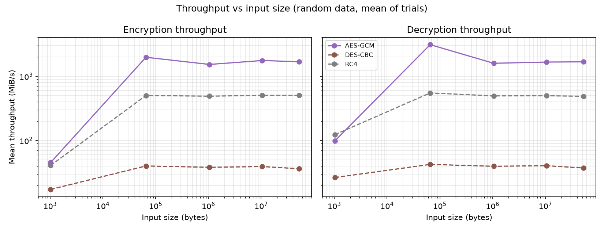
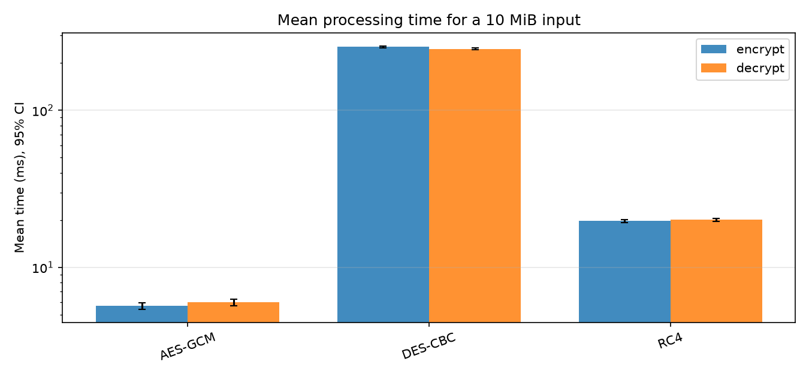
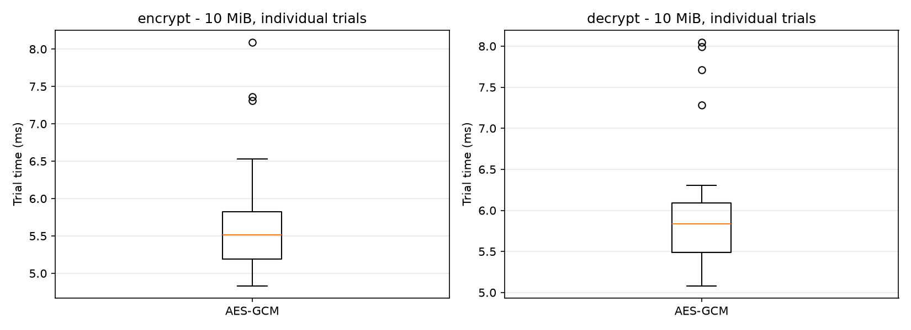
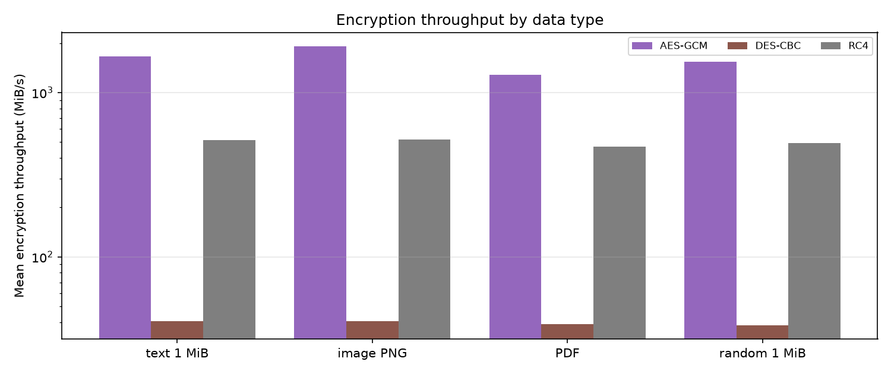
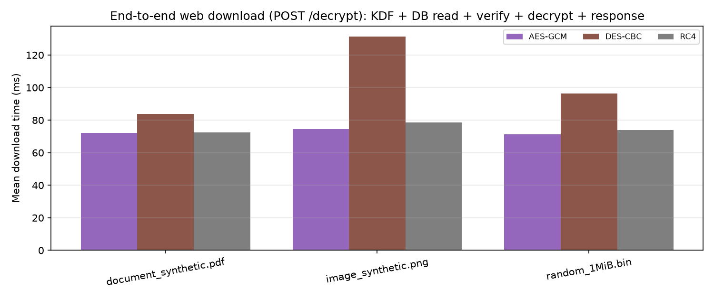

# Secure Personal Health Vault
## Three-Algorithm Performance Evaluation

## 1. Scope and objective
This report compares three configurations: AES-256-GCM, DES-CBC, and RC4. AES-GCM is the recommended choice for protecting real vault data because it provides authenticated encryption. DES and RC4 are obsolete and are included only for academic comparison; they must not be used to protect real personal or health records.

The benchmark measures the implementation configurations available in this project. AES-GCM includes its authentication tag. DES-CBC and RC4 use separate HMAC-SHA256 integrity protection in the application, so raw-cipher timing is not a comparison of identical security mechanisms. Application download timings include more than the cipher operation.

## 2. Environment and methodology
| Environment item | Value |
| --- | --- |
| Python | 3.13.7 (CPython) |
| Cryptography library | 50.0.2 |
| OpenSSL | OpenSSL 4.0.3 29 Sep 2026 |
| Operating system | Windows-11-10.0.26200-SP0 |
| Processor | Intel64 Family 6 Model 183 Stepping 1, GenuineIntel |
| Logical CPUs visible | 24 |
| Measured trials | 30 |
| Warm-up runs | 3 |
| Benchmark started (UTC) | 2026-10-27T12:41:12Z |
| Benchmark finished (UTC) | 2026-10-27T12:43:30Z |

The benchmark uses synthetic input files and measures encryption and decryption separately. Throughput is reported in MiB/s, where 1 MiB = 1,048,576 bytes. Timing results are machine- and workload-dependent; they should not be generalized to every computer or deployment.

## 3. Mean performance on 10 MiB input

| Algorithm | Operation | Mean (ms) | SD (ms) | Mean throughput (MiB/s) | 95% CI half-width (ms) |
| --- | --- | --- | --- | --- | --- |
| AES-256-GCM | encrypt | 5.669 | 0.771 | 1763.88 | 0.276 |
| AES-256-GCM | decrypt | 5.992 | 0.779 | 1668.78 | 0.279 |
| DES-CBC (legacy) | encrypt | 253.871 | 9.985 | 39.39 | 3.573 |
| DES-CBC (legacy) | decrypt | 246.280 | 9.414 | 40.60 | 3.369 |
| RC4 (legacy stream cipher) | encrypt | 19.745 | 1.120 | 506.47 | 0.401 |
| RC4 (legacy stream cipher) | decrypt | 20.056 | 1.051 | 498.61 | 0.376 |

## 4. Throughput across file sizes

### Encrypt throughput

| Algorithm | 1 KiB | 64 KiB | 1 MiB | 10 MiB | 50 MiB |
| --- | --- | --- | --- | --- | --- |
| AES-256-GCM | 45.53 | 1981.82 | 1532.86 | 1763.88 | 1689.33 |
| DES-CBC (legacy) | 17.37 | 40.22 | 38.34 | 39.39 | 36.46 |
| RC4 (legacy stream cipher) | 41.03 | 503.14 | 491.05 | 506.47 | 504.93 |

### Decrypt throughput

| Algorithm | 1 KiB | 64 KiB | 1 MiB | 10 MiB | 50 MiB |
| --- | --- | --- | --- | --- | --- |
| AES-256-GCM | 98.98 | 3115.14 | 1597.84 | 1668.78 | 1682.97 |
| DES-CBC (legacy) | 26.57 | 42.56 | 39.77 | 40.60 | 37.42 |
| RC4 (legacy stream cipher) | 123.77 | 551.58 | 496.08 | 498.61 | 489.81 |

## 5. End-to-end application download

| Algorithm | document_synthetic.pdf | image_synthetic.png | random_1MiB.bin |
| --- | --- | --- | --- |
| AES-256-GCM | 72.23 | 74.43 | 71.31 |
| DES-CBC (legacy) | 83.78 | 131.33 | 96.24 |
| RC4 (legacy stream cipher) | 72.42 | 78.56 | 73.90 |

These timings include application-level work such as key derivation, database access, decryption, and response handling, depending on the benchmark harness. They should not be interpreted as raw cipher throughput.

## 6. File I/O measurements

| File | Size (bytes) | Mean read (ms) | Mean write (ms) |
| --- | --- | --- | --- |
| random_1KiB.bin | 1024 | 0.087 | 0.381 |
| random_64KiB.bin | 65536 | 0.150 | 0.495 |
| document_synthetic.pdf | 559953 | 0.183 | 1.572 |
| text_1MiB.txt | 1048576 | 0.299 | 0.808 |
| random_1MiB.bin | 1048576 | 0.355 | 0.698 |
| image_synthetic.png | 2457390 | 0.870 | 1.015 |
| random_10MiB.bin | 10485760 | 3.050 | 3.173 |
| random_50MiB.bin | 52428800 | 14.880 | 28.133 |

## 7. Integrity and ciphertext observations

| Algorithm | Result after ciphertext bit flip | Plaintext rejected |
| --- | --- | --- |
| AES-256-GCM | decryption rejected (authentication/padding failure) | Yes |
| DES-CBC (legacy) | decrypted with errors | No |
| RC4 (legacy stream cipher) | decrypted with errors | No |

### Ciphertext sizes

| Algorithm | Plaintext 0 B | Plaintext 1 B | Plaintext 15 B | Plaintext 16 B | Plaintext 17 B | Plaintext 31 B | Plaintext 32 B | Plaintext 1000 B |
| --- | --- | --- | --- | --- | --- | --- | --- | --- |
| AES-256-GCM | 16 | 17 | 31 | 32 | 33 | 47 | 48 | 1016 |
| DES-CBC (legacy) | 8 | 8 | 16 | 24 | 24 | 32 | 40 | 1008 |
| RC4 (legacy stream cipher) | 0 | 1 | 15 | 16 | 17 | 31 | 32 | 1000 |

## 8. Interpretation and limitations
- AES-GCM is the recommended choice for the vault because it provides confidentiality and integrity using authenticated encryption. Its 12-byte nonce must never be reused with the same key; the 16-byte authentication tag detects tampering.
- DES is obsolete and its effective key strength is inadequate for modern security. RC4 is an obsolete stream cipher with known keystream biases. Both are included only for academic comparison.
- The app uses a separate HMAC-SHA256 for DES-CBC and RC4, whereas AES-GCM has a built-in authentication tag. Raw benchmark timings do not include all application security overhead unless the benchmark explicitly measures the full application path.
- Results depend on CPU, operating system, cryptography/OpenSSL versions, input size, system load, and number of trials. A single run is not a universal performance ranking.
- Synthetic fixtures are not real patient data. The benchmark does not establish legal compliance or production readiness.
- Separate KDF timing data: PBKDF2 iteration count 600000; mean 101.41 ms across 20 trials. This value is contextual and is not added to raw cipher-only timings.

## 9. Conclusion
The benchmark compares AES-256-GCM, DES-CBC, and RC4 using the available measurements. Select AES-GCM for real vault data; the legacy algorithms are retained only to satisfy the academic comparison requirement. Discuss measured differences using the generated tables and graphs, while distinguishing raw cipher timing from application download latency.

---
Generated from the current files in `benchmark/results/`. Regenerate this report after the final benchmark run; do not submit filtered or stale results as fresh measurements.
